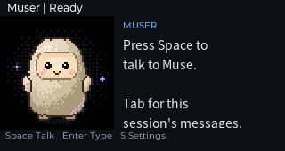
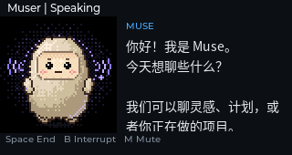
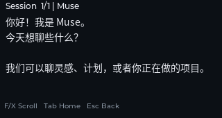
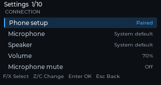
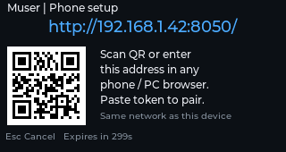

<p align="center">
  
</p>

<div align="center">
  <h1>Muser</h1>
</div>

<div align="center">
  <p>An independent Muse voice companion for Cardputer Zero: continuous voice, live captions and keyboard chat on a 320×170 display.</p>
</div>

<p align="center" style="margin: 20px 0; display: flex; justify-content: center; flex-wrap: wrap; gap: 12px;">
  
  
  
  
  
  
</p>

> [!IMPORTANT]
> **Muser is an unofficial community project.** It is not affiliated with Meta,
> and is not endorsed or sponsored by Meta. Muse and related marks belong to
> Meta and its affiliates; they are used only to describe the service this app
> connects to. You need your own Muse account, a personal SDK token and the
> Muse phone app to pair a device.

Muser is a Cardputer Zero application built on the official Muse Linux SDK. A
C++/LVGL front end renders the 320×170 interface on the device framebuffer and
evdev keypad, or in an SDL desktop simulator. A separate Python worker owns the
Muse session, audio, captions and setup flow; the two processes exchange JSON
Lines. Voice runs in its own Noise session with the `hatch-web` App ID, while
text chat follows the paired account's main Muse conversation.

The application opens when launched and ends its call and Python child process
when closed. It installs no background service and exposes no remote shell or
file operation.

## Features

- 128×128 pixel avatar with connection, listening, thinking and speaking
  states, animated by playback level.
- Push-to-talk with automatic endpointing: press Space once to start a call and
  once to end it. Half-duplex by default; microphone upload pauses while Muse
  speaks.
- Streaming user and assistant captions with final-text correction. Replies
  from before a barge-in are fenced off so stale audio and text cannot leak
  into the next turn.
- Text chat from the keyboard through the paired account's main conversation.
- English and Simplified Chinese UI, English by default. Settings → Language
  switches immediately; both UI languages show Chinese and English captions,
  and switching does not translate conversation content.
- Session-only conversation view with scrolling and clearing; up to 256
  entries or 2 MiB total, held in memory. No recordings or dialogue are
  written to disk.
- Mute, key-driven barge-in, independent playback volume, input/output device
  selection, and configurable idle and call timeouts.
- In-app phone setup: open the displayed LAN address, paste a personal SDK
  token, then complete Bluetooth pairing from the Muse phone app.
- Settings rows show labels and values in separate columns, with the active row
  highlighted. F/X/Z/C navigate without Fn.

> [!NOTE]
> Clearing the session view and exiting only drop local memory; they do not
> delete the conversation on the Muse service. Text chat uses the account's
> main conversation. When the phone and Muser post to the same conversation at
> the same time, the service may not fully distinguish the two sources.

## Screenshots

| Home | Speaking |
| --- | --- |
|  |  |
| **History** | **Settings** |
|  |  |

The setup page is shown on the device during first-time pairing:



Captures come from the real LVGL UI. The demo QR code is illustrative and does
not connect to a real setup service.

## Repository Layout

```text
.
├── assets/                 # Fonts, images and branding
│   ├── branding/           # Original project logo
│   ├── fonts/              # Noto Sans CJK SC and its OFL license
│   └── images/             # Launcher icon
├── backend/muser/          # Python worker: audio, setup, transcripts, diagnostics
├── cmake/toolchains/       # Cardputer Zero aarch64 cross toolchain
├── packaging/              # Debian/APPLaunch metadata and Docker build image
├── screenshots/            # 320×170 simulator captures
├── scripts/                # Bootstrap, desktop runner, ARM64 build, release check
├── src/                    # C++/LVGL UI and platform layer
├── tests/                  # Offline tests plus pinned upstream SDK tests
├── vendor/                 # Muse SDK, license texts, wheels, LVGL licenses
├── CMakeLists.txt          # Build graph and Debian package description
├── CMakePresets.json       # Desktop and Cardputer Zero configure/build presets
├── app-builder.json        # Store metadata
├── config.example.json     # Example settings file
├── LICENSE                 # Apache-2.0
├── NOTICE                  # Copyright and upstream attributions
└── THIRD_PARTY_LICENSES.md # Component licenses and SDK modification notes
```

## Build

Requirements: CMake 3.31+, a C++17 compiler, Python 3.9+, `uv`, SDL2, FreeType
and libpng. On macOS install the native dependencies with:

```shell
brew install cmake sdl2 freetype libpng
```

### Desktop simulator

```shell
./scripts/bootstrap.sh
cmake --preset desktop
cmake --build --preset desktop -j8
./scripts/run-desktop.sh --demo
```

`--demo` **does not connect to Muse and does not open the microphone**; text
replies come from fixed demo content. Without `--demo`, an existing local
pairing may be used, but first-time Bluetooth pairing requires a Linux device
with BlueZ. The simulator window can be scaled; the UI itself is always
320×170.

```shell
./scripts/run-desktop.sh --self-test
./scripts/run-desktop.sh --capture-all screenshots
.venv/bin/python -m pytest tests -q
```

The `--self-test` mode exercises UI routing and exits. `--capture-all` writes
the screenshots used above.

### ARM64 package

The official BSP is the target sysroot. The CMake toolchain downloads it to
`.cache/sdk_bsp-src` when it is missing. On Debian/Ubuntu Linux with
`aarch64-linux-gnu-gcc/g++`, CMake 3.31+ and `make`:

```shell
./scripts/bootstrap.sh
cmake --workflow --preset cp0-cross-package
```

The repository also provides a Docker entry point that pins the build image:

```shell
./scripts/build-arm64.sh

# Reuse an existing BSP read-only:
MUSER_BSP_DIR=/absolute/path/to/sdk_bsp-src ./scripts/build-arm64.sh
```

The artifact is `dist/muser_0.2.8_arm64.deb`. It targets the current official
BSP's ARM64 system and requires glibc ≥ 2.38 and libstdc++ ≥ 13.2; apt checks
those versions. The package contains the UI, SDK, pinned websockets and
sounddevice wheels, fonts, icons and the APPLaunch entry. Python cryptography,
D-Bus, GI, CFFI and PortAudio come from the system. No token, pairing state or
chat content is bundled.

| CMake option | Default | Description |
| --- | --- | --- |
| `USE_DESKTOP` | `ON` | Build the SDL desktop simulator; set `OFF` for the Cardputer Zero target. |

## Install and Pair

A device needs Python 3.9+, networking, BlueZ, the Muse phone app and a personal
SDK token.

```shell
sudo apt install ./muser_0.2.8_arm64.deb
```

All configuration happens inside Muser; there is no separate setup command.

1. Open **Muser** in the Launcher, press **Space**, or choose
   **S → Phone setup → Enter**.
2. On first setup the screen enlarges the full `http://IP:port/` address and a
   QR code. Connect the phone or computer to the same LAN and open the address
   by scanning or typing it.
3. The page links to the official
   [Muse Gadgets SDK token page](https://gadgets.muse.ai/settings/sdk-tokens).
   Create or copy a personal token there, paste it into the setup page and
   press **Import & pair**. No long string has to be typed on the device.
4. After the token is stored and the success page is sent, Muser closes the
   HTTP listener, starts Bluetooth pairing and shows the device name.
5. In the Muse phone app open **Settings → Devices → Developer mode** and add
   the `MuseGadgetXXXXXX` name shown on the device.
6. Confirm the prompt on the phone. Muser connects to the default Muse and
   Space starts voice.

A device that already has an SDK token goes straight to Bluetooth pairing. The
setup page listens on the device's LAN address only while setup is active, at
the root path `/`; there is no random URL, Host/Origin restriction or hidden
form code. Only the basic format needed to save an SDK token is checked. A
successful submit, Esc, a five-minute timeout or closing the app stops the
setup server and closes the port. The Bluetooth pairing window is ten minutes.

Muser leaves the Bluetooth pairing page as soon as the phone confirms and
starts connecting to Muse. "Paired" and "connected to Muse" are tracked
separately: timeouts, a temporarily unavailable Muse VM or a short disconnect
keep the saved credentials and retry automatically; Space on the home screen
retries immediately. Only an explicit unbind or authorization revocation from
the SDK asks for pairing again. Connection diagnostics store the phase, HTTP
status, paired flag and update time in a private `connection-status.json`; no
token or conversation content is included.

This is a networked Linux device, so Muser does not implement ESP32-style Wi-Fi
provisioning. The Muse phone app's unified flow may still show a Wi-Fi picker;
the official Linux SDK only uses the current connection for confirmation,
ignores SSID/password fields and never changes system Wi-Fi. After pairing,
BLE advertising stops, so the device no longer appears in the add-device scan
list; that is expected.

**The two token types are different.** The SDK token identifies an SDK device;
the Muse phone app delivers account pairing credentials over Bluetooth. The
official protocol does not mint an SDK token during Bluetooth pairing, hence
the copy-and-paste import. The public package contains no developer token. See
the official [SDK Token Terms](https://gadgets.muse.ai/sdk-terms) for token
distribution rules.

Credentials are stored for the current app user. On the validated device the
Launcher is a user-level service for `pi`, so state lives in
`~/.local/share/muser` (or `$XDG_STATE_HOME/muser`); an explicit root launch
uses `/var/lib/muser`. Directories are mode `700` and credential files `600`.
`MUSER_STATE_DIR` overrides the state directory. Upgrades keep existing
credentials; removing the package does not delete personal state.

Muser uses the device's existing BlueZ configuration. Neither the package nor
the app edits `/etc/bluetooth/main.conf`, installs an authorization policy or
restarts the system Bluetooth service. The official Linux SDK notes that some
Android pairing flows need `[GATT] ExchangeMTU = 256`; if a device hits a real
pairing incompatibility, confirm and handle it separately — Muser does not
change system configuration on its own.

If the Launcher does not show the entry after installation, run
`systemctl --user restart APPLaunch.service` as the Launcher's user, or log in
again. On the device these services belong to the user session, not to a
system-level `APPLaunch.service`.

A Muse VM accepts one voice call at a time; a new call may replace a call on
the phone or another device.

The default idle timeout is 45 seconds and the call cap is 300 seconds; both
are configurable. A dropped control channel reconnects automatically. A voice
call does not redial or resume capture on its own; press Space again.

## Keys

| Key | Action |
| --- | --- |
| Space | Open phone setup when unpaired; retry the Muse connection when paired but offline; start/end voice when connected |
| B | Interrupt playback and keep talking |
| M | Mute or unmute the microphone |
| Z / C, or Left / Right | Playback volume; in Settings, adjust the current row |
| Enter | End voice and open the text input; send while editing |
| Tab | Switch between Home and History |
| F / X, or Up / Down | Menu selection and scrolling; at a history edge, move to the previous/next entry |
| S | Settings |
| Short Esc | Back; hang up on the home screen during a call |
| Long Esc (700 ms) | End the call, release resources and exit |

Only the text field treats F/X/Z/C, other letters and Space as text. While
editing, arrows move the cursor and Backspace/Delete remove characters. There
is no Chinese pinyin input method.

## Audio

Muser prefers a 24 kHz capture stream, then 48 kHz and the device's native
rate. A 48→24 kHz path uses the SDK's FIR filter; other rates use a streaming
linear resampler. The protocol is always mono PCM16LE at 24 kHz. If an audio
device disconnects, stops or overflows its buffer, the call ends with a retry
prompt.

The Cardputer Zero default input is opened as 24 kHz stereo, selecting the
stronger channel per block. The system audio layer owns sample-rate conversion,
which keeps the capture callback light. The board has one built-in microphone;
the default mix includes a silent second channel, which lowers the effective
level. Captured speech is also quiet and low-frequency-heavy, so the upload
path applies a 120 Hz high-pass, up to 4× (12 dB) makeup gain and a per-block
peak limit of 30,000 to avoid clipping.

Live audio is uploaded in 40 ms frames, paced so send time does not accumulate
into the next frame interval. Audio queued before the call is admitted is
discarded at connect. `Z` / `C` adjust Muser's playback volume, default 70%; at
100% the original PCM amplitude reaches the system audio layer and system
volume still controls the speaker.

Settings persist in a private `preferences.json`; the format is shown in
`config.example.json`. Chat content and recordings are never written there.

## Configuration

| Environment variable | Purpose |
| --- | --- |
| `MUSER_ROOT` | Asset root; `/usr/share/muser` on the device |
| `MUSER_PYTHON` | Python interpreter; development scripts default to `.venv/bin/python` |
| `MUSER_STATE_DIR` | Private app state directory |
| `MUSER_SETUP_HOST` | Optional listen address for phone setup; defaults to the detected LAN address |
| `LV_LINUX_FBDEV_DEVICE` | Explicit framebuffer device |
| `MUSER_INPUT_DEVICE` | Explicit evdev keypad device |

The device prefers `/dev/fb_lcd`, otherwise scans `/proc/fb` for `fb_st7789v`
or `panel-mipi-dbid`; it does not assume `/dev/fb0`. The keypad defaults to
`/dev/input/by-path/platform-3f804000.i2c-event` and reads its character map
from `/usr/share/keymaps/tca8418_keypad_m5stack_keymap.map`.

## Privacy and Diagnostics

`chat-status.json` and `voice-status.json` record only a phase, time, error
type and HTTP status. They contain no token, text or recording. The voice
connection uses the official default Noise App ID; brief audio overflow or
underflow increments a callback-warning counter and does not end a stream that
is still running.

Muser writes `logs/muser.log` in the private state directory. On the validated
device with the `pi` Launcher that is
`/home/pi/.local/share/muser/logs/muser.log`. Each file is capped at 256 KiB
with three rotated backups, about 1 MiB total; the directory is mode `700` and
files are `600`.

Logs contain key actions, call start/stop/end reasons, microphone level and
peak, audio device and rate, upload frame counts, server input-hold state,
playback queue and error types, plus a five-second running summary. They do not
store recordings, dialogue text, tokens, device credentials or raw server
messages.

To collect diagnostics, package only the log directory:

```shell
tar -czf /tmp/muser-logs.tar.gz -C /home/pi/.local/share/muser logs
```

Do not package the whole state directory: it also holds the SDK token and
pairing credentials. Reading or packaging logs never opens the microphone.

## Testing

```shell
./scripts/bootstrap.sh
.venv/bin/python -m pytest tests -q
```

Automated tests use simulated services, synthetic PCM and fictional identities;
they do not use real tokens, recordings or online accounts. The current suite
passes 720 tests with 2 skipped. Desktop builds and tests do not prove hardware
capture/playback, Bluetooth pairing or the live Muse service; those remain
manual device checks.

## Limitations

Muser keeps conversation history only in memory and does not export it. It has
no wake word, camera, device control, multi-Muse or multi-thread selection, or
history sync. It does not include a Chinese pinyin input method.

## Contributing

Issues and pull requests are welcome. Please keep changes testable offline,
avoid committing credentials or recordings, and describe any device or account
testing that was performed.

## License

Muser is licensed under the **Apache License, Version 2.0**. The full text is in
[LICENSE](LICENSE), and copyright and upstream attributions are in
[NOTICE](NOTICE).

Apache-2.0 was chosen because the project vendors and modifies the Muse Gadget
SDK, which is Apache-2.0, and because it provides an explicit patent grant.
Portions that began from the MIT-licensed CardputerZero Template retain their MIT
notices. Third-party components and their licenses are recorded in
[THIRD_PARTY_LICENSES.md](THIRD_PARTY_LICENSES.md) and the per-component license
files under `vendor/` and `assets/fonts/`.

The Jollybot avatar is excluded from the upstream Apache License and is not
relicensed by this project. See the avatar notice in
[THIRD_PARTY_LICENSES.md](THIRD_PARTY_LICENSES.md) before redistributing it.
Muse and related marks belong to Meta; Muser is not affiliated with, endorsed by
or sponsored by Meta.

## Upstream

- [Cardputer Zero development skill](https://github.com/CardputerZero/skill)
- [Cardputer Zero Template](https://github.com/CardputerZero/Template)
- [Muse Linux Device SDK](https://github.com/facebookincubator/muse-gadget-sdk/tree/main/linux)
- [Muse Gadgets](https://gadgets.muse.ai/)
